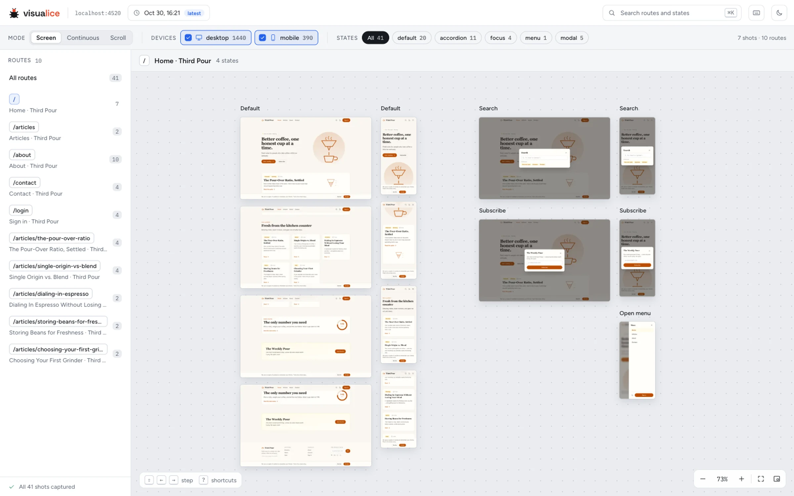

<picture>
  <source media="(prefers-color-scheme: dark)" srcset="assets/banner/banner-dark.png">
  
</picture>

Point your agent at a website and visualice catalogues every page and every state those
pages can be in, on every device you configure: open menus and modals, but also form
errors, a cart with items in it, signed-in views and multi-step flows. Then you browse
them all on one zoomable canvas.

- **Explores like a QA reviewer.** The crawler maps the pages and the obvious states, then
  an agent works through each kind of page and finds the ones a crawler can't.
- **Repeatable without the agent.** Every state is saved as a recipe the engine replays,
  so reruns are fast and identical, and CI can recapture the whole catalogue on every
  deploy with no agent involved.
- **Shows what users see.** Pages are captured one screen at a time, as a user scrolls, so
  sticky headers, cookie bars and modal backdrops look the way they really do.



## Get started with Claude Code

Needs Node 22.18 or newer.

```
/plugin marketplace add alexdevlabs/visualice
/plugin install visualice@visualice
```

Then run `/visualice https://your.site`, or ask Claude to "catalogue every screen of
https://your.site". It maps the site, shows you the plan (the kinds of page, how many
screenshots, anything exploring would change on the site) and asks once, explores each
kind of page in parallel, captures everything, and `/visualice-view` opens the result.

- Later runs replay what's mapped and explore only what's new.
- `/visualice-explore <focus>` widens the catalogue on purpose: a section like
  `/checkout*`, or something to hunt for, like form errors.
- `/visualice https://your.site --quick` skips exploring: the crawler on its own.

**Other agents** (Codex, Cursor, Gemini CLI, …): [`AGENTS.md`](AGENTS.md) points them at
the skill, which is plain Markdown and works anywhere. Agents without subagents explore
one kind of page at a time ([the explore flow][explore]).

Either way, two files appear next to you: `visualice.config.json` for settings, and
`visualice.routes.md`, a list of the pages and states found. Edit the list to steer the
next run: add a page it missed, or mark one to skip. Everything else goes in a gitignored
`.visualice/` folder.

## Without an agent

The engine is a CLI of its own: the quick path, and what CI runs.

```bash
npm i -g visualice                  # or run it without installing: npx visualice <command>
visualice doctor                    # checks Node, the browser and the viewer, and fixes what it can
visualice crawl https://your.site   # find pages and states with the heuristics, and screenshot them
visualice serve --open              # browse the results
```

| To…                                | Run or set                                                          |
| ---------------------------------- | ------------------------------------------------------------------- |
| See how big a crawl will be first  | `visualice crawl <url> --dry-run`                                   |
| Recapture without rediscovering    | `visualice crawl --replay`                                          |
| Limit what's crawled               | `--max-pages=20 --exclude='/admin/**'`, or `scope` in the config    |
| Capture pages only, no states      | `visualice crawl --no-states`                                       |
| Crawl a site behind a login        | a login recipe in the config, then `visualice auth` ([guide][auth]) |
| Add devices, browsers or dark mode | `devices` in the config ([configuration][config])                   |
| Check accessibility as well        | `checks.accessibility: true`                                        |
| Share the results without a server | `visualice export report/`                                          |
| Use it in CI                       | `--replay --json --quiet --fail-on-error` ([crawling][crawling])    |

A good split: let your agent build the catalogue once, then have CI run
`visualice crawl --replay` on every deploy. The explored states live in the site model,
`.visualice/crawl-map.cache.json`, so commit it with `git add -f` (or restore it from a CI
cache) next to the config and routes file.

## Docs

- [Crawling][crawling]: commands, the routes file, discovery, output layout
- [Configuration][config]: every option worth knowing, other browsers, component shots,
  accessibility
- [The viewer][viewer]: navigation, view modes, full screen, shortcuts, sharing
- [Logging in][auth]: login recipes, sessions, secrets
- [CLI reference][cli]: every command and flag
- [The explore flow][explore]: how agents map, explore and capture a site
- [Using it as a library](docs/library.md)
- [Changelog](CHANGELOG.md), including known limitations

## Contributing

See [`CONTRIBUTING.md`](CONTRIBUTING.md). Report security issues privately, as described in
[`SECURITY.md`](SECURITY.md).

## Use it responsibly

Only crawl sites you own or are allowed to test. visualice stays on the target site, follows
robots.txt unless you turn that off, and while discovering it never submits forms that change
data or clicks controls that look destructive (delete, sign out, pay).

## License

MIT, see [`LICENSE`](LICENSE). The viewer bundles the Figtree and IBM Plex Mono fonts, both
under the SIL Open Font License 1.1; their licence texts ship in `viewer/dist/licenses/`.

[crawling]: docs/crawling.md
[config]: docs/configuration.md
[viewer]: docs/viewer.md
[auth]: skills/visualice/references/auth.md
[cli]: skills/visualice/references/cli.md
[explore]: skills/visualice/references/explore-mode.md
